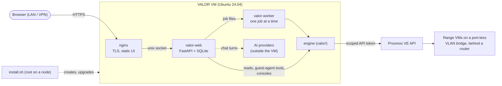
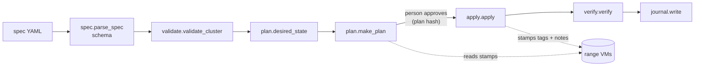

# VALOR architecture

How the code is put together: the components, where each responsibility lives, and how a range goes from a
description to verified VMs. For using VALOR see [USER-GUIDE.md](USER-GUIDE.md); for working on the code see
[DEVELOPMENT.md](DEVELOPMENT.md).

- [The one rule](#the-one-rule)
- [Components](#components)
- [Repository layout](#repository-layout)
- [The engine (`valor/`)](#the-engine-valor)
- [How a build works, in code](#how-a-build-works-in-code)
- [Jobs and the worker](#jobs-and-the-worker)
- [The web service (`valor/web/`)](#the-web-service-valorweb)
- [AI: chat builder and range agent](#ai-chat-builder-and-range-agent)
- [The installer (`installer/`)](#the-installer-installer)
- [The web UI (`web/`)](#the-web-ui-web)
- [Files inside the VALOR VM](#files-inside-the-valor-vm)
- [Security boundaries](#security-boundaries)

## The one rule

**The agent plans, the engine executes.** AI output is text: a range spec, or a tool call that VALOR checks and (for
anything that changes something) a person approves. Only the engine calls the Proxmox API, with one
least-privilege token, and every build or teardown runs a plan a person approved. New features keep this boundary.

The second rule is **portability**: nothing in the code names a node, storage, bridge, network or VMID. The
installer discovers them and writes them into `/etc/valor/config.toml`; the engine reads them from
[`valor/config.py`](../valor/config.py) and refuses to run when a required one is missing.

## Components



| Process | Unit | What it does |
|---|---|---|
| nginx | `nginx` | TLS termination, security headers, serves `web/dist`, proxies `/api/` and the console websocket to `valor-web`. Config: [`appliance/nginx.conf`](../appliance/nginx.conf). |
| Web API | [`valor-web.service`](../appliance/valor-web.service) | `valor-web serve --uds /run/valor-web/web.sock`: accounts, sessions, settings, ranges, plans, chats, consoles. Runs chat turns in background threads and watches for failed builds. |
| Job worker | [`valor-worker.service`](../appliance/valor-worker.service) | `valor-web worker`: takes queued jobs and runs them through the engine. A separate service, so restarting the web API never interrupts a build. |
| Certificate | `valor-tls.timer` | Renews VALOR's own TLS certificate ([`appliance/valor-tls`](../appliance/valor-tls)). |

Both Python services run as the unprivileged `valor` user with systemd sandboxing (read-only system, `ReadWritePaths`
limited to `/var/lib/valor`, a `@system-service` syscall filter). The firewall
([`appliance/nftables.conf`](../appliance/nftables.conf)) lets in HTTPS from the allowed networks and SSH from the
Proxmox nodes only.

## Repository layout

| Path | What |
|---|---|
| [`install.sh`](../install.sh), [`installer/`](../installer/) | The installer. Runs as root on a Proxmox node; Python standard library only. |
| [`appliance/`](../appliance/) | Everything installed inside the VALOR VM: `setup.sh`, nginx, nftables, systemd units, `requirements.lock`. |
| [`valor/`](../valor/) | The engine: spec, validate, plan, apply, verify, destroy, lifecycle, journal; the AI client and the range agent's tools; the `valor`, `valor-admin` and `valor-mcp` entry points. |
| [`valor/web/`](../valor/web/) | The web API (FastAPI), its database and the job worker. |
| [`web/`](../web/) | The web UI (React, TypeScript, Vite, React Flow). `web/dist` is built and committed. |
| [`roles/`](../roles/) | Services: `role.sh` (Linux) and/or `role.ps1` (Windows) plus `role.yaml`. See [CONTENT.md](CONTENT.md). |
| [`baselines/`](../baselines/) | Hardening profiles and the compliance framework mapping. |
| [`templates/`](../templates/) | OS catalog (`catalog.toml`), ISO catalog (`isos.toml`), publisher signing keys, cloud-init vendor data. |
| [`ranges/`](../ranges/), [`journals/`](../journals/) | Example specs, and the journals from the MVP's reference builds. |
| [`tests/`](../tests/) | `pytest`, no cluster needed. |
| [`ci/`](../ci/) | Example CI pipelines that use the `valor` CLI. |
| [`eval/`](../eval/) | The MVP metrics script (rebuild fidelity, idempotence, timing). |
| [`.claude/`](../.claude/), [`.mcp.json`](../.mcp.json) | The Claude Code development harness: skills and the MCP server config. `spec-reference.md` in it is also the product's AI prompt (see [AI](#ai-chat-builder-and-range-agent)). |
| [`tools/lock.py`](../tools/lock.py) | Regenerates `appliance/requirements.lock`. |

## The engine (`valor/`)

| Area | Module | Responsibility |
|---|---|---|
| Spec | [`spec.py`](../valor/spec.py) | Pydantic models (`RangeSpec`, `Segment`, `Host`, `Rule`, `Test`, `WireGuard`, `Compliance`), safe YAML parsing, defaults, the canonical form and its hash (the spec version), and automatic tests (`effective_tests`). |
| | [`validate.py`](../valor/validate.py) | Checks against the live cluster: templates exist, VLANs free and in range, networks not reserved or used by other ranges, roles exist and fit the OS family, memory. |
| Planning | [`plan.py`](../valor/plan.py) | `desired_state()` turns a spec into one `Desired` per VM with two hashes: `hw_hash` (OS, template, NICs, size) and `conv_hash` (hardware + roles + baseline + policy + login + WireGuard). `make_plan()` compares them with what is stamped on each VM. |
| Building | [`apply.py`](../valor/apply.py) | The idempotent build ([below](#how-a-build-works-in-code)). `Steps` records every step for the job log, structured errors and the journal. |
| | [`netpolicy.py`](../valor/netpolicy.py) | Compiles the policy into the router's nftables ruleset: forward default drop, one accept per rule, NAT egress only for `internet: true` segments and never to private or reserved networks. Also the temporary build egress. |
| | [`roles.py`](../valor/roles.py) | Loads roles, resolves parameters (host names become `/32`, segment names their network), builds the script with VALOR's shell helpers (`PRELUDE`). |
| | [`baseline.py`](../valor/baseline.py) | Loads baseline profiles (with `extends:`), bundles their controls into one script, parses `VALOR-CONTROL` result lines. |
| | [`windows.py`](../valor/windows.py) | Windows hosts have no cloud-init: guest preparation (name, address, DNS, Administrator password), the PowerShell role wrapper, the baseline bundle and probes. |
| | [`kickstart.py`](../valor/kickstart.py), [`iso9660.py`](../valor/iso9660.py) | `install: iso` for Rocky/Alma: a kickstart on an `OEMDRV` CD, written by a pure-Python ISO writer (the worker's sandbox blocks `genisoimage`). |
| | [`credentials.py`](../valor/credentials.py) | The range login: one generated password per range, encrypted, set in the guests over stdin. |
| | [`wireguard.py`](../valor/wireguard.py) | Keys (X25519, generated in Python), tunnel addresses, router and peer configs, `wg show` parsing. Keys are stored encrypted. |
| Checking | [`verify.py`](../valor/verify.py) | Connectivity probes from inside the guests (`/dev/tcp` or `ping` on Linux, a PowerShell probe on Windows), baseline checks on every host, the WireGuard check and the compliance report. |
| | [`compliance.py`](../valor/compliance.py) | Which baseline a framework needs, design checks, and the per-requirement report from `baselines/frameworks/frameworks.yaml`. |
| Lifecycle | [`destroy.py`](../valor/destroy.py), [`lifecycle.py`](../valor/lifecycle.py) | Teardown (only VMs in the range pool with the range's tag), power, snapshots and rollback. |
| | [`drafts.py`](../valor/drafts.py) | Drafts of a built range: map edits as operations on the spec (`apply_ops`), a plan-like overlay without asking the cluster, canonical YAML and diffs. |
| | [`blueprints.py`](../valor/blueprints.py) | Blueprint storage and `plan_copies()`: free VLANs and networks per copy, hosts keep their position, per-student WireGuard peers. |
| | [`isos.py`](../valor/isos.py) | ISO library: catalog resolution (newest point release, signed checksum lists), downloads and uploads as Proxmox tasks. |
| | [`journal.py`](../valor/journal.py) | Writes `journals/<range>.md` (Mermaid topology, tables, verification matrix, history). |
| Plumbing | [`pve.py`](../valor/pve.py) | The Proxmox API client (`proxmoxer`): VMs, clones, tasks, snapshots, the guest agent (`exec`, `ps` for PowerShell, file read/write). The only module that talks to Proxmox. |
| | [`cluster.py`](../valor/cluster.py) | Finds range VMs by pool and tags, parses VALOR's metadata in VM notes, finds templates by tag, `cluster_info()`. |
| | [`jobs.py`](../valor/jobs.py), [`ops.py`](../valor/ops.py), [`state.py`](../valor/state.py) | Job records and events, the engine lock, running a job (`ops.execute`), per-range results and history. |
| | [`config.py`](../valor/config.py), [`errors.py`](../valor/errors.py), [`crypto.py`](../valor/crypto.py) | Configuration, structured errors (`ValorError`: code, message, step, host, details, hint, completed steps), AES-256-GCM secrets at rest. |
| AI | [`ai.py`](../valor/ai.py), [`agent.py`](../valor/agent.py) | Providers and prompts; the range agent's tools and the read-only command classifier ([below](#ai-chat-builder-and-range-agent)). |
| Entry points | [`cli.py`](../valor/cli.py), [`admin.py`](../valor/admin.py), [`mcp_server.py`](../valor/mcp_server.py) | `valor` (CLI), `valor-admin` (root tasks on the development cluster), `valor-mcp` (MCP server for the Claude Code harness). See [CLI.md](CLI.md). |

## How a build works, in code



1. **Parse and validate.** `spec.load_spec` parses the YAML (errors never echo file content), fills defaults and
   checks the schema. `validate.validate_cluster` checks it against the cluster.
2. **Plan.** `plan.desired_state` builds the target state; `plan.make_plan` reads each VM's stamp (tags
   `valor`, `valor-range-<name>`, `valor-spec-<version>`, plus metadata in the VM notes: the hardware spec, the
   converged hash and the spec version) and classifies it: `create`, `update`, `replace`, `converge`, `start`,
   `restamp`, `keep` or `remove`.
3. **Apply** (`apply.apply`), in this order:
   - delete VMs to be replaced or removed; create VMs (linked clones of templates, or an empty VM plus installer
     and kickstart CDs for `install: iso`); resize; change ISO media; start;
   - wait for the guest agents, Windows setup and cloud-init; map the router's NICs to interface names by MAC;
   - **router: temporary build egress**, so every segment can reach package mirrors;
   - per host, in waves (a host whose role waits for another, such as an AD member and its domain controller, comes
     later): range login, roles, baseline;
   - **router: final policy**, also restored when a build fails, so egress is never left open; WireGuard;
   - stamp the spec version on every VM.

   A VM whose `conv_hash` already matches is skipped, so an unchanged spec applies with zero changes.
4. **Verify** (`verify.verify`): the explicit and automatic tests (policy, isolation, egress) from inside the
   guests, every baseline check on every host, the WireGuard check, and the compliance report.
5. **Record**: `state` keeps the last apply and verification and the history; `journal.write` regenerates the
   journal; after a verified build `ops` takes the `valor-clean` snapshot (its failure never fails the build).

Every failure is a `ValorError` with the failed step, the host, the last lines of output, a hint and the completed
steps. That structure is what the job log, the CLI's `--json`, the MCP tools and the fix-a-failed-build assistant
work from.

## Jobs and the worker

Anything that changes the cluster is a job: `apply`, `verify`, `destroy`, `power`, `snapshot`, `rollback`,
`snapshot_delete`, `rotate` (range login) and `wg_rotate` (WireGuard keys).

- `jobs.create` writes `jobs/<id>/job.json` (state `queued`); the id is `YYYYMMDD-HHMMSS-<6 hex>`.
- In the VALOR VM (`job_runner = "worker"`) the worker service picks the oldest queued job; on a development install
  (`"spawn"`) a detached process runs it.
- `ops.execute` takes the **engine lock** (`engine.lock`, `flock`): one infrastructure job at a time. Progress events
  go to `jobs/<id>/events.jsonl`, the result to `job.json`.
- On start the worker marks jobs left `running` by a previous worker as failed (`interrupted`); a spawned job
  process that dies ends as `runner_died`. When a job ends the worker writes an audit entry and sends notifications.

`./install.sh --upgrade` waits for running and queued jobs before it restarts the services.

## The web service (`valor/web/`)

| Module | Responsibility |
|---|---|
| [`app.py`](../valor/web/app.py) | App factory: the `guard` middleware (same-origin and JSON-only checks on state changes, security headers, `no-store` on the API), error handlers, `API_ROUTERS` (every router; the security tests walk it), and the failed-build watcher thread. |
| [`core.py`](../valor/web/core.py) | Sessions (`__Host-` cookie, hashed id, stages `mfa` / `enroll` / `full`), `require(role)`, CSRF, audit helper, `ApiError`. |
| [`db.py`](../valor/web/db.py) | SQLite (WAL); the schema is versioned with `PRAGMA user_version` and migrated at start. Tables: users, recovery codes, sessions, audit, settings, notifications, AI usage, chats and messages. |
| [`security.py`](../valor/web/security.py) | Argon2id, TOTP with replay protection, recovery codes, tokens, rate limiter. |
| [`auth.py`](../valor/web/auth.py), [`ldapauth.py`](../valor/web/ldapauth.py), [`users.py`](../valor/web/users.py) | Sign-in (password, then TOTP or enrollment), LDAP/AD with group-to-role mapping, account administration. |
| [`ranges.py`](../valor/web/ranges.py) | Ranges, specs, plans, approved builds, verify, destroy, logins, power, snapshots, jobs. |
| [`editing.py`](../valor/web/editing.py), [`topology.py`](../valor/web/topology.py) | Drafts and map edits; the map's nodes and edges with the plan overlay. |
| [`chats.py`](../valor/web/chats.py), [`builder.py`](../valor/web/builder.py) | Saved chats and their background turns; AI provider settings, usage and budgets. |
| [`consoles.py`](../valor/web/consoles.py), [`access.py`](../valor/web/access.py) | Console relay (VNC and serial websockets via one-time tickets); WireGuard peers. |
| [`isos.py`](../valor/web/isos.py), [`blueprints.py`](../valor/web/blueprints.py) | ISO library and blueprints. |
| [`settings.py`](../valor/web/settings.py), [`notify.py`](../valor/web/notify.py), [`status.py`](../valor/web/status.py) | Notification channels, LDAP settings, audit log, in-app notifications; sending (SMTP and webhooks); the health page. |
| [`worker.py`](../valor/web/worker.py), [`cli.py`](../valor/web/cli.py), [`config.py`](../valor/web/config.py) | The job worker, `valor-web` commands, the `[web]` config section. |

**Approval.** `POST /api/ranges/{name}/plan` returns the plan and its hash (the spec version plus each VM's action).
`apply` computes
the plan again and refuses with `409 plan_changed` if the hash differs, so the build runs exactly what was approved.
Blueprint deploys use the same pattern (`deploy_hash`).

**Drafts.** Map edits and chat changes are written to `draft.yaml` next to the range's state, never to the spec.
Approving a draft's plan replaces the spec with the draft and starts the build.

The routes, their access levels and the request conventions are listed in [API.md](API.md).

## AI: chat builder and range agent

**Providers** ([`ai.py`](../valor/ai.py)): `Anthropic` (Messages API), `OpenAICompatible` (any `/v1` server, such as
LM Studio or vLLM) and `OpenRouter`. Answers are streamed; the timeout is how long a model may stay silent. Reasoning
that a model writes inline (`<think>`) or as separate events is shown as "thinking". Tool calls that a local model
writes into its text (`<tool_call>` tags) are recovered. Provider settings and encrypted keys live in the settings
table; `builder.resolve` picks a chat's provider (or the default, then the others as a fallback for failed-build
fixes).

**The prompt** (`ai.reference`) is assembled per request from:

- [`spec-reference.md`](../.claude/skills/range-build/spec-reference.md) (copied into the VALOR VM as
  `/opt/valor/share/spec-reference.md`): **editing this file changes what the AI is told**;
- the compliance frameworks, the OS templates present on this cluster, every role with its parameters, and the
  cluster facts (VLANs in use, reserved networks...);
- `SPEC_RULES` and the mode's instructions in `ai.py`.

**Chat builder** (mode `build`): `ai.build` asks the model, extracts the last YAML block, repairs common YAML slips,
validates it (`builder.spec_check`: schema, unique name, cluster) and asks the model to fix the problems, up to
`FIX_ROUNDS` times. Questions come back as a ` ```questions ` block and are shown as cards.

**Range chats** ([`chats.py`](../valor/web/chats.py) `Turn`): a turn runs in a background thread; the browser polls
the assistant message, whose `meta.steps` is a live feed (reasoning, text, tool calls with output, VALOR's checks).

- *Question* mode gets the read tools; *Code* mode gets all of [`agent.TOOLS`](../valor/agent.py): `run_command`,
  `read_file`, `write_file`, `power`, `snapshot`, `range_status`, `update_spec`. *Plan* mode has no tools: the
  model's spec becomes the draft.
- `agent.validate` checks every call; `agent.is_readonly` decides whether a command only reads: every part of the
  command line must be on an allowlist of reporting commands (with argument checks such as `sed -n` without `-i`).
  Redirections into files, command substitution and anything it cannot parse need approval.
- A call that needs approval stops the loop; `POST .../decide` records the person's decision and the turn continues
  (`run_pending`). `allow_all` on a chat skips approvals.
- `update_spec` validates the spec and saves it as the range's draft.

**Failed builds** (`chats.watch_failed_builds`, a thread in the web service): builds that failed in the last 30
minutes start a Code-mode chat (`start_fix`) with `fix_prompt(job)`. In mode `auto` VALOR rebuilds when the assistant
is done (`continue_fix`), up to 3 rounds, stops if a rebuild fails the same way again, and never runs a plan that
replaces or removes a VM.

## The installer (`installer/`)

Python standard library only, so it runs on any Proxmox VE 8.2+ node without installing anything. It works through
`pvesh`, `pveum` and `qm` ([`sh.py`](../installer/sh.py)).

| Module | Responsibility |
|---|---|
| [`cli.py`](../installer/cli.py) | `install.sh` modes: install, `--status`, `--upgrade`, `--uninstall`, `--template`. |
| [`discover.py`](../installer/discover.py) | Read-only facts: version, nodes, storages (linked-clone support), bridges, management network and VLAN, networks in use, VMIDs, CPU flags, existing install record. Parsing is separate from the commands, so it is tested with captured output. |
| [`answers.py`](../installer/answers.py) | Settings: detected defaults, interactive editing, validation (`problems`), TOML answers files. |
| [`identity.py`](../installer/identity.py) | Proxmox roles, the token-only user, the privilege-separated token, pools and ACLs; the check that the token gets 403 on the VALOR VM. |
| [`network.py`](../installer/network.py) | The port-less range bridge with backup, diff check and a rollback timer. |
| [`templates.py`](../installer/templates.py), [`windows.py`](../installer/windows.py), [`wim.py`](../installer/wim.py) | OS templates from signed cloud images; Windows templates from ISOs (unattended setup, VirtIO tools, sysprep; the edition is picked by name from `install.wim`). |
| [`appliance.py`](../installer/appliance.py), [`guest.py`](../installer/guest.py) | The VALOR VM: create it, copy the payload and secrets in over the guest agent, run `appliance/setup.sh`, check health. |
| [`record.py`](../installer/record.py) | The install record in `/etc/pve/priv/valor/<id>.json`: what this installation created, written after every step (resume, upgrade and uninstall use it). |
| [`ui.py`](../installer/ui.py) | Terminal output and prompts (plain text when not on a terminal). |

## The web UI (`web/`)

React and TypeScript, built with Vite; the map uses React Flow (`@xyflow/react`), consoles use noVNC and xterm.js.

| Path | What |
|---|---|
| `src/App.tsx` | Sign-in gate, app shell (menu, theme, notifications) and hash routing (`#/ranges/<name>`, `#/jobs/<id>`...). |
| `src/api.ts`, `src/hooks.ts` | API client (JSON, the `X-CSRF-Token` header, 401 handling) and hooks (`useRoute`, polling `useApi`). |
| `src/pages/` | One file per page: Dashboard, Ranges, RangeDetail, RangeEditor, Builder, Chats, Blueprints, Library, Jobs, Console, Users, Audit, Settings, Account, SignIn. |
| `src/components/Topology.tsx` | The map: nodes, edges, plan colors, details panel. |
| `src/components/RangeEditing.tsx`, `SegmentEditing.tsx` | Map editing (VMs, services, segments, traffic rules), the draft bar and the range chat panel. |
| `src/components/ChatFeed.tsx` | The chat feed: streamed steps, approval cards, question cards. Used by the builder and range chats. |
| `src/components/PlanModal.tsx`, `RangeActions.tsx`, `Access.tsx` | Plan review and approval; power, snapshots and logins; WireGuard peers. |

`web/dist` is committed, so installing VALOR never needs Node.js; CI fails when it is out of date.

## Files inside the VALOR VM

| Path | Owner | Contents |
|---|---|---|
| `/etc/valor/config.toml` | root:valor 0640 | Engine and web settings, written by the installer. |
| `/etc/valor/token.json`, `pve-ca.pem` | root:valor | The Proxmox API token, and the API's CA if it is not publicly trusted. |
| `/etc/valor/secret.key` | root:valor 0640 | The 32-byte key for secrets at rest (AES-256-GCM). |
| `/etc/valor/ssh/` | valor | The engine's SSH key, put into range VMs for break-glass access. |
| `/etc/valor/tls/` | root | Web certificate and VALOR's CA. |
| `/opt/valor/lib`, `/opt/valor/venv` | root | The `valor` package and its hash-pinned dependencies. |
| `/opt/valor/share/` | root | Roles, baselines, templates, `spec-reference.md`, example specs. |
| `/opt/valor/web/` | root | The built web UI (served by nginx). |
| `/var/lib/valor/web.sqlite3` | valor | Accounts, sessions, audit log, settings, chats. |
| `/var/lib/valor/data/` | valor | `ranges/*.yaml` (specs), `journals/*.md`, `blueprints/`. |
| `/var/lib/valor/state/jobs/<id>/` | valor | `job.json`, `events.jsonl`. |
| `/var/lib/valor/state/state/ranges/<name>/` | valor | `last-apply.json`, `last-verify.json`, `history.jsonl`, `draft.yaml`, `credentials.json` and `wireguard.json` (both encrypted). |
| `/var/log/valor-setup.log` | root | The last install or upgrade inside the VM. |

## Security boundaries

The security model is summarized in the [README](../README.md#security-model). In code:

- **Proxmox**: [`installer/identity.py`](../installer/identity.py) defines every privilege the token gets; the VALOR
  VM sits in a pool the token has no rights on, and the installer and the health page check that it gets HTTP 403
  there.
- **Ranges**: [`netpolicy.py`](../valor/netpolicy.py) (deny by default, no private destinations for egress),
  the port-less bridge from [`installer/network.py`](../installer/network.py).
- **Web**: [`app.py`](../valor/web/app.py) `guard`, [`core.py`](../valor/web/core.py) `require`, and
  [`tests/test_security.py`](../tests/test_security.py), which fails when a route has no reviewed access level.
- **Secrets**: never on a command line or in a VM config. Passwords and keys reach guests over the guest agent's
  stdin; they are encrypted at rest with [`crypto.py`](../valor/crypto.py); specs, chats and logs hold none.
- **AI**: models only produce text and tool calls. Specs are validated, changes inside VMs wait for approval unless
  a person allowed them for that chat, and builds go through plan -> approve.
